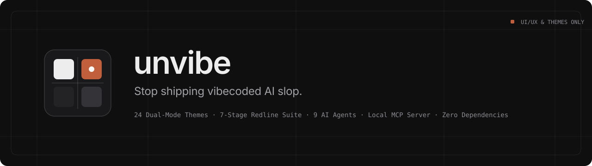
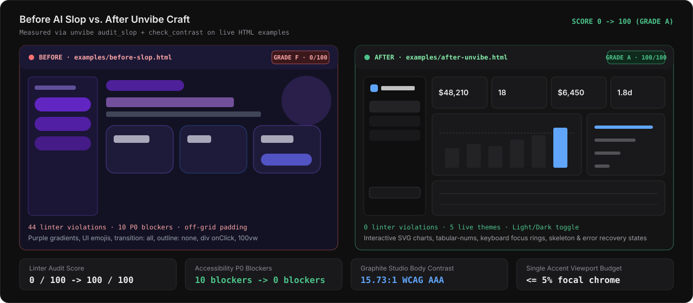
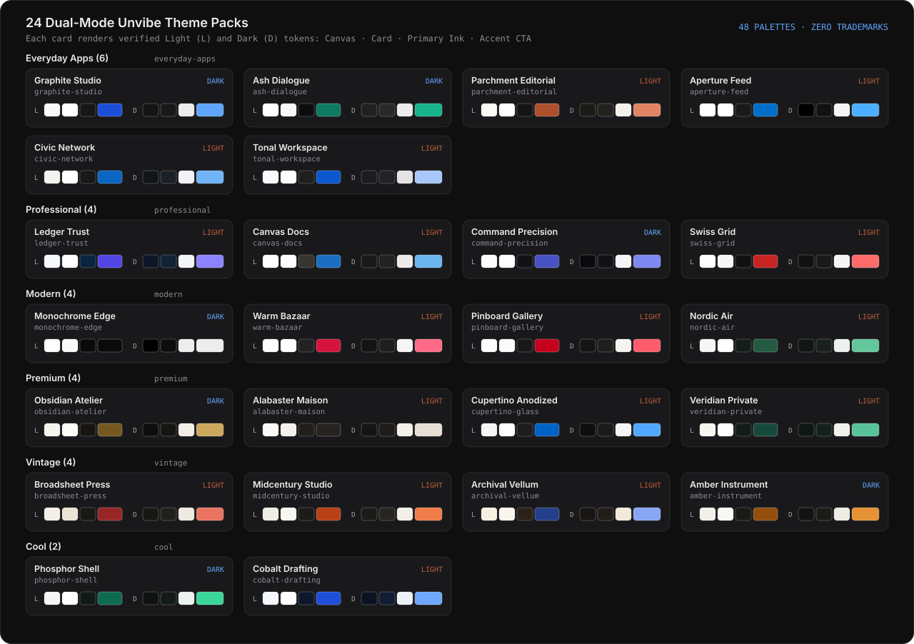
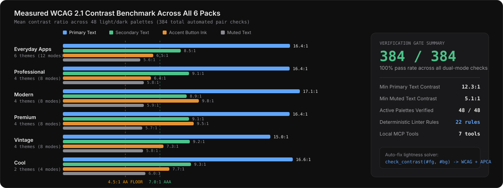
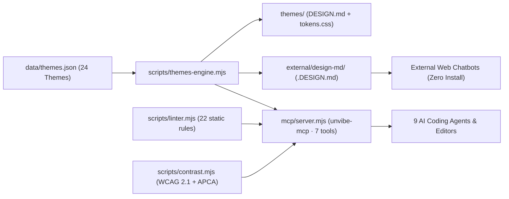

<div align="center">



<p>
  
  = 18" />
  
  
  
  
  
</p>

**Stop shipping vibecoded AI slop.**  
A zero-dependency anti-slop UI/UX craft system featuring **24 dual-mode `DESIGN.md` themes**, a **7-stage Redline audit suite**, a **22-rule deterministic static linter**, **9 AI coding agent adapters**, and a local **MCP server (`unvibe-mcp`)**.

[Before vs. After](#before-vs-after-proof) · [24 Theme Gallery](#24-dual-mode-theme-gallery) · [Contrast Benchmarks](#mathematical-contrast-benchmarks) · [7-Stage Redline](#architecture--7-stage-redline-pipeline) · [Quick Start](#60-second-quick-start) · [MCP & CLI](#mcp-server-unvibe-mcp--cli)

</div>

---

> **STRICT SCOPE — UI/UX & THEMES ONLY**  
> Every rule, skill, prompt, and MCP tool in **Unvibe** governs **visual design, layout proportions, color themes, typography, motion, accessibility, and frontend UX states exclusively**. Unvibe never touches backend logic, API contracts, database schemas, or non-UI code, and instructs agents to ignore its rules completely on non-UI tasks.

---

## Why `unvibe`?

Default LLM interfaces fail in predictable ways: glowing purple gradients, off-grid margins, UI emojis replacing line icons, unverified contrast ratios, catch-all transitions, and placeholder copy. **Unvibe** replaces ad-hoc prompting with curated neutral ramps, WCAG/APCA math, and automated static verification:

| Default AI Slop | With `unvibe` |
| :--- | :--- |
| Purple-to-blue gradients, gradient text, neon halos, floating blobs | Quiet neutral ramps (`--bg-deep` → `--bg-card`) + **1** focal `--accent` (`<=5%` viewport) |
| Random emojis (`✨🚀🔥👋`) used as sidebar & button icons | Uniform `16–18px` SVG line icons (`stroke-width: 1.5`) + quiet `<kbd>` shortcuts |
| `Welcome back, Alex! 👋`, `Supercharge your workflow!!`, `$123,456` | Domain-specific workspace headings, baseline deltas (`+12.4% vs September 2026`), `tabular-nums` |
| `transition: all`, `animate-pulse` on static cards, `width: 100vw` | Compositor-only `transform`/`opacity`, `prefers-reduced-motion`, `overflow-x: clip` |
| Bare `outline: none`, `<div onClick>`, sub-`16px` mobile inputs | Visible `:focus-visible`, native `<button>`/`<a>`, `>=44px` touch targets |
| Every project renders with identical SaaS boilerplate | **24 contrast-verified dual-mode themes** across **6 curated packs** |

---

## Before vs. After Proof

Both standalone HTML screens ship in [`examples/`](./examples/) and are audited automatically in CI on every commit:



| Screen | Linter Score | Grade | Findings Breakdown | Interactive & Craft Capabilities |
| :--- | :---: | :---: | :--- | :--- |
| [`examples/before-slop.html`](./examples/before-slop.html) | `0 / 100` | **F** | `44` total (`10 P0`, `22 P1`, `12 P2`) | Static slopped markup with off-grid offsets, purple blobs, bare `outline: none`, `100vw` trap |
| [`examples/after-unvibe.html`](./examples/after-unvibe.html) | `100 / 100` | **A** | `0 P0`, `0 P1`, `0 P2` | **Live 5-theme switcher + Light/Dark toggle**, interactive SVG multi-series chart, client tier breakdown, searchable table, `Live / Loading / Empty / Error` UI states, CSV export |

Reproduce both audits directly:

```powershell
node scripts/cli.mjs audit examples/before-slop.html
node scripts/cli.mjs audit examples/after-unvibe.html
```

---

## 24 Dual-Mode Theme Gallery

Every theme in [`data/themes.json`](./data/themes.json) includes verified **Light** and **Dark** color palettes, geometric radii, typography pairings, elevation tokens, interactive state rules, responsive breakpoints, and a standalone `.DESIGN.md` spec with **zero third-party trademarks**.



| Pack | Count | Visual Direction | Browse Docs |
| :--- | :---: | :--- | :--- |
| **Everyday Apps** | `6` | Ergonomic neutral chat shells, editorial paper, photo streams, directories, tonal workspace surfaces | [`themes/README.md`](./themes/README.md#everyday-apps-everyday-apps-6-themes) |
| **Professional** | `4` | High-trust financial ledgers, structured docs, command trackers, Swiss architectural grids | [`themes/README.md`](./themes/README.md#professional-professional-4-themes) |
| **Modern** | `4` | Monochrome developer edge, warm commerce accents, crisp masonry galleries, Scandinavian calm | [`themes/README.md`](./themes/README.md#modern-modern-4-themes) |
| **Premium** | `4` | Obsidian brushed brass, warm limestone maison, anodized sapphire aluminum, heritage forest green | [`themes/README.md`](./themes/README.md#premium-premium-4-themes) |
| **Vintage** | `4` | Broadsheet newsprint, 1960s workshop poster ink, archival parchment, anodized amber instrumentation | [`themes/README.md`](./themes/README.md#vintage-vintage-4-themes) |
| **Cool** | `2` | Phosphor terminal developer tooling and cyanotype architectural blueprint sheets | [`themes/README.md`](./themes/README.md#cool-cool-2-themes) |

<details>
<summary><strong>Browse all 24 themes with Light/Dark accent tokens & direct DESIGN.md links</strong></summary>

| Theme ID | Pack | Default Mode | Light / Dark Accents | Best For | Spec |
| :--- | :--- | :---: | :--- | :--- | :--- |
| `graphite-studio` | `everyday-apps` | `dark` | `#1D4ED8` / `#60A5FA` | SaaS dashboards, analytics suites | [`DESIGN.md`](./themes/everyday-apps/graphite-studio/DESIGN.md) |
| `ash-dialogue` | `everyday-apps` | `dark` | `#0E7A5F` / `#19B38B` | AI assistants, chat interfaces | [`DESIGN.md`](./themes/everyday-apps/ash-dialogue/DESIGN.md) |
| `parchment-editorial` | `everyday-apps` | `light` | `#AE4F2E` / `#E08463` | Writing studios, knowledge readers | [`DESIGN.md`](./themes/everyday-apps/parchment-editorial/DESIGN.md) |
| `aperture-feed` | `everyday-apps` | `light` | `#006EC7` / `#4DAEFF` | Photo feeds, creator networks | [`DESIGN.md`](./themes/everyday-apps/aperture-feed/DESIGN.md) |
| `civic-network` | `everyday-apps` | `light` | `#0A66C2` / `#70B5F9` | Professional networks, job boards | [`DESIGN.md`](./themes/everyday-apps/civic-network/DESIGN.md) |
| `tonal-workspace` | `everyday-apps` | `light` | `#0B57D0` / `#A8C7FA` | Mail clients, cloud drives | [`DESIGN.md`](./themes/everyday-apps/tonal-workspace/DESIGN.md) |
| `ledger-trust` | `professional` | `light` | `#5145E5` / `#8C84FF` | Fintech, billing platforms | [`DESIGN.md`](./themes/professional/ledger-trust/DESIGN.md) |
| `canvas-docs` | `professional` | `light` | `#1B6EC2` / `#6CB4EE` | Wikis, documentation portals | [`DESIGN.md`](./themes/professional/canvas-docs/DESIGN.md) |
| `command-precision` | `professional` | `dark` | `#4752C4` / `#7D88F0` | Issue trackers, developer tools | [`DESIGN.md`](./themes/professional/command-precision/DESIGN.md) |
| `swiss-grid` | `professional` | `light` | `#C82323` / `#FF6B6B` | Architecture firms, data journals | [`DESIGN.md`](./themes/professional/swiss-grid/DESIGN.md) |
| `monochrome-edge` | `modern` | `dark` | `#0A0A0A` / `#EDEDED` | Cloud platforms, CLI dashboards | [`DESIGN.md`](./themes/modern/monochrome-edge/DESIGN.md) |
| `warm-bazaar` | `modern` | `light` | `#D4143D` / `#FF6B86` | Marketplaces, booking platforms | [`DESIGN.md`](./themes/modern/warm-bazaar/DESIGN.md) |
| `pinboard-gallery` | `modern` | `light` | `#C4001D` / `#FF5C6C` | Moodboards, asset libraries | [`DESIGN.md`](./themes/modern/pinboard-gallery/DESIGN.md) |
| `nordic-air` | `modern` | `light` | `#235A42` / `#63C79B` | Climate tech, health & wellness | [`DESIGN.md`](./themes/modern/nordic-air/DESIGN.md) |
| `obsidian-atelier` | `premium` | `dark` | `#755720` / `#CCA85E` | Flagship showcases, bespoke studios | [`DESIGN.md`](./themes/premium/obsidian-atelier/DESIGN.md) |
| `alabaster-maison` | `premium` | `light` | `#262321` / `#E6DFD5` | Fashion houses, interior architecture | [`DESIGN.md`](./themes/premium/alabaster-maison/DESIGN.md) |
| `cupertino-glass` | `premium` | `light` | `#0062C4` / `#52A8FF` | Consumer hardware, native web apps | [`DESIGN.md`](./themes/premium/cupertino-glass/DESIGN.md) |
| `veridian-private` | `premium` | `light` | `#184A3B` / `#5AC29B` | Wealth management, legal practices | [`DESIGN.md`](./themes/premium/veridian-private/DESIGN.md) |
| `broadsheet-press` | `vintage` | `light` | `#992626` / `#E87461` | Newsletters, longform publications | [`DESIGN.md`](./themes/vintage/broadsheet-press/DESIGN.md) |
| `midcentury-studio` | `vintage` | `light` | `#B84014` / `#F07C4A` | Creative schools, hardware studios | [`DESIGN.md`](./themes/vintage/midcentury-studio/DESIGN.md) |
| `archival-vellum` | `vintage` | `light` | `#253F8A` / `#88A6F2` | Coffee roasteries, artisan goods | [`DESIGN.md`](./themes/vintage/archival-vellum/DESIGN.md) |
| `amber-instrument` | `vintage` | `dark` | `#944E0E` / `#E59235` | Audio plugins, field instruments | [`DESIGN.md`](./themes/vintage/amber-instrument/DESIGN.md) |
| `phosphor-shell` | `cool` | `dark` | `#0E6B4F` / `#3BD69A` | Terminal tools, CI/CD monitors | [`themes/cool/phosphor-shell/DESIGN.md`](./themes/cool/phosphor-shell/DESIGN.md) |
| `cobalt-drafting` | `cool` | `light` | `#1D4ED8` / `#6EA8FE` | CAD tools, mapping & spatial apps | [`themes/cool/cobalt-drafting/DESIGN.md`](./themes/cool/cobalt-drafting/DESIGN.md) |

</details>

---

## Mathematical Contrast Benchmarks

Every palette across both `light` and `dark` modes is tested programmatically via [`scripts/contrast.mjs`](./scripts/contrast.mjs) (`WCAG 2.1` + `APCA Lc`)—**384 total color-pair checks** (`24 themes × 2 modes × 8 semantic pairs`).



| Theme Pack | Palettes Tested | Primary Text Range | Avg Primary Ratio | Avg Secondary Ratio | Avg Muted Ratio | Avg Accent Button | WCAG Pass Rate |
| :--- | :---: | :---: | :---: | :---: | :---: | :---: | :---: |
| **Everyday Apps** | `12` (`6 × 2`) | `13.3:1 – 19.4:1` | `16.40:1` | `8.52:1` | `5.59:1` | `6.53:1` | `100%` |
| **Professional** | `8` (`4 × 2`) | `12.3:1 – 18.9:1` | `16.37:1` | `9.10:1` | `5.85:1` | `6.37:1` | `100%` |
| **Modern** | `8` (`4 × 2`) | `15.9:1 – 19.8:1` | `17.10:1` | `8.95:1` | `5.86:1` | `9.83:1` | `100%` |
| **Premium** | `8` (`4 × 2`) | `15.5:1 – 17.7:1` | `16.38:1` | `9.12:1` | `5.74:1` | `9.46:1` | `100%` |
| **Vintage** | `8` (`4 × 2`) | `13.6:1 – 15.7:1` | `14.97:1` | `9.16:1` | `5.80:1` | `7.26:1` | `100%` |
| **Cool** | `4` (`2 × 2`) | `16.5:1 – 16.7:1` | `16.59:1` | `9.26:1` | `5.96:1` | `7.70:1` | `100%` |

---

## Architecture & 7-Stage Redline Pipeline

### System Data Flow



### Structured Redline Audit Sequence (`skills/redline/`)

When cleaning up existing frontend interfaces, [`skills/redline/`](./skills/redline/SKILL.md) enforces strict UI/UX scope isolation and walks sequentially through seven structural layers:

```mermaid
flowchart LR
    A["0. audit_slop + Visual Brief"] --> S1["1. Layout & Viewport"]
    S1 --> S2["2. 4px Grid & Radii"]
    S2 --> S3["3. Neutral Ramp & Contrast"]
    S3 --> S4["4. Type & Tabular Nums"]
    S4 --> S5["5. Line Icons & Media"]
    S5 --> S6["6. Copy & Real States"]
    S6 --> S7["7. Motion & A11y"]
    S7 --> G["Grade A Gate (0 P0 / 0 P1)"]
```



| File | Purpose |
| :--- | :--- |
| [`skills/redline/SKILL.md`](./skills/redline/SKILL.md) | Entry workflow, Light Polish vs. Full Overhaul triage, Five-Line Visual Brief, Distinctiveness Test |
| [`references/README.md`](./skills/redline/references/README.md) | Reading order and `unvibe-mcp` integration guide |
| [`references/audit-matrix.md`](./skills/redline/references/audit-matrix.md) | Pattern-to-fix diagnostic table mapped across Unvibe's 22 static rules |
| [`references/stages.md`](./skills/redline/references/stages.md) | Ordered 7-stage execution playbook (`Layout → 4px Grid → Contrast → Type → Media → States → Motion & A11y`) |
| [`references/baseline-tokens.md`](./skills/redline/references/baseline-tokens.md) | 4px spacing scale, desktop dimensions, concentric radii, motion timings, and verified starter palettes |
| [`references/media-and-surfaces.md`](./skills/redline/references/media-and-surfaces.md) | Real coded UI previews, CLS-safe aspect ratios, edge fades, CSS duotone, GPU surface limits |
| [`references/i18n-rtl.md`](./skills/redline/references/i18n-rtl.md) | CSS logical properties, directional icon mirroring rules, `<bdi>` isolation, `Intl` formatting, script typography |

---

## 60-Second Quick Start

### Priority #1: Antigravity (Global Plugin)

```powershell
git clone https://github.com/2208Prathamesh/unvibe.git
cd unvibe
npm run install:antigravity
```

Installs globally into `~/.gemini/config/plugins/unvibe/` with:
- **Always-On Rules (`rules/AGENTS.md`)** — enforces the 12-rule Anti-Slop Floor strictly on UI tasks
- **2 Skills (`skills/unvibe/`, `skills/redline/`)** — greenfield theming & 7-stage Redline audit suite
- **Local MCP Server (`unvibe-mcp`)** — exposes all 7 tools automatically across every workspace

### Multi-Agent Compatibility Matrix (9 Environments)

| Environment | Native Artifacts | Install / Setup |
| :--- | :--- | :--- |
| **Antigravity** *(Priority #1)* | `plugin.json` + `rules/AGENTS.md` + `skills/*` + `mcp_config.json` | `npm run install:antigravity` |
| **Claude Code** | `.claude-plugin/{plugin,marketplace}.json` + `.mcp.json` + `skills/*` | `npm run install:claude` |
| **Cursor** | `rules/cursor-unvibe.mdc` (globs) + `.cursor/mcp.json` | `node scripts/install.mjs --target cursor --project <dir>` |
| **OpenAI Codex CLI** | `skills/*/agents/openai.yaml` + MCP TOML | `npm run install:codex` |
| **OpenCode** | `skills/*/agents/openai.yaml` + local MCP config | `npm run install:opencode` |
| **Windsurf** | `rules/windsurf-unvibe.md` (`trigger: glob`) + MCP | `node scripts/install.mjs --target windsurf --project <dir>` |
| **GitHub Copilot / VS Code** | `rules/copilot-unvibe.instructions.md` (`applyTo`) + `.vscode/mcp.json` | `node scripts/install.mjs --target copilot --project <dir>` |
| **Gemini CLI** | `gemini-extension.json` + `rules/AGENTS.md` + `unvibe-mcp` | `gemini extensions link .` |
| **External Web Chatbots** | `external/UNVIBE-SKILL.md` + `external/design-md/*.DESIGN.md` | Paste directly (zero install) |

Full setup guide: [`docs/AGENT-SETUP.md`](./docs/AGENT-SETUP.md).

### External Web Chatbots (Zero Install)

1. Pick any standalone theme file from [`external/design-md/`](./external/README.md) (for example [`graphite-studio.DESIGN.md`](./external/design-md/graphite-studio.DESIGN.md) or [`parchment-editorial.DESIGN.md`](./external/design-md/parchment-editorial.DESIGN.md)).
2. Paste it alongside [`external/UNVIBE-SKILL.md`](./external/UNVIBE-SKILL.md) (or [`prompts/chatbot-system-prompt.md`](./prompts/chatbot-system-prompt.md) / [`prompts/redline-prompt.md`](./prompts/redline-prompt.md)) into any web chatbot.
3. Or drop a theme directly into a project directory:
   ```powershell
   node scripts/cli.mjs export parchment-editorial "C:\path\to\your-project"
   ```

---

## 22-Rule Deterministic Linter (`audit_slop`)

<details>
<summary><strong>Inspect all 22 static audit rules across P0-BLOCKER (5), P1-SLOP (9), and P2-POLISH (8)</strong></summary>

| Severity | Penalty | Rule IDs Checked | What It Catches |
| :--- | :---: | :--- | :--- |
| **`P0-BLOCKER`** | `-15` | `a11y-outline-none`, `motion-transition-all`, `layout-100vw-overflow`, `a11y-div-onclick`, `a11y-user-scalable-no` | Missing `:focus-visible`, catch-all `transition: all`, `100vw` overflow trap, non-semantic `<div onClick>`, disabled pinch zoom |
| **`P1-SLOP`** | `-7` | `slop-eyebrow-tracking`, `slop-purple-gradient`, `slop-gradient-text`, `slop-colored-glow`, `slop-emoji-ui`, `slop-hype-copy`, `slop-badge-spam`, `slop-loop-animation`, `motion-layout-prop` | Tracked uppercase eyebrows, purple/blue AI gradients, gradient text, neon halos, UI emojis, hype/greetings, promo badge spam, idle `animate-pulse`, layout property transitions |
| **`P2-POLISH`** | `-2` | `layout-overflow-hidden-root`, `slop-fake-data`, `slop-heavy-heading`, `spacing-arbitrary-offgrid`, `a11y-mobile-input-zoom`, `typography-ellipsis-dots`, `motion-no-reduced-motion`, `dark-color-scheme-missing` | Root `overflow-x: hidden`, dummy `$123,456` / `Lorem ipsum`, weight `800–900` UI heads, off-4px utilities, sub-16px `<input>`, ASCII `...`, missing reduced-motion fallback, missing `color-scheme: dark` |

</details>

---

## MCP Server (`unvibe-mcp`) & CLI

Zero-dependency stdio JSON-RPC 2.0 MCP server at [`mcp/server.mjs`](./mcp/server.mjs) exposing **7 tools**:

| Tool | Description |
| :--- | :--- |
| `list_themes` | Filter all 24 themes by `pack`, `defaultMode`, `surfaceMode`, or `search` |
| `get_theme` | Fetch complete Light & Dark hex palettes, font pairings, geometry, motion, and `DESIGN.md` preview |
| `recommend_themes` | Score all 24 themes against a project description and return top 3 with verified contrast scores |
| `generate_tokens` | Output `css`, `tailwind-v4`, `tailwind-v3`, or `design-md` |
| `audit_slop` | Run all 22 deterministic UI-slop, motion, spacing, layout, and accessibility rules on files or snippets |
| `check_contrast` | Compute exact `WCAG 2.1` ratio + `APCA Lc` + lightness-preserving accessible hex suggestion |
| `get_checklist` | Fetch structured checklists (`redline`, `new-build`, `accessibility`, `motion`, `forms`, `dashboard`, `landing`) |

CLI cookbook:

```powershell
node scripts/cli.mjs list --pack vintage
node scripts/cli.mjs recommend "collaborative telemetry dashboard" --mode dark --surface operate
node scripts/cli.mjs generate graphite-studio --format tailwind-v4
node scripts/cli.mjs export ledger-trust ./my-app
node scripts/cli.mjs audit ./src
node scripts/cli.mjs contrast "#888888" "#FFFFFF"
node scripts/cli.mjs checklist redline
```

---

## Repository Structure

```text
unvibe/
├── plugin.json                        # Antigravity plugin manifest
├── gemini-extension.json              # Gemini CLI extension manifest
├── mcp_config.json                    # Antigravity MCP config template
├── .mcp.json                          # Claude Code / Cursor project MCP config
├── .vscode/mcp.json                   # VS Code / Copilot MCP config
├── .claude-plugin/                    # Claude Code plugin & marketplace manifests
├── .github/                           # Cross-OS verify CI workflow, PR & issue templates
├── AGENTS.md                          # Repo maintainer guide for coding agents
├── docs/AGENT-SETUP.md                # Setup instructions across all 9 environments
├── assets/                            # Brand marks + generated SVG benchmark visualizations
├── rules/
│   ├── AGENTS.md                      # Always-on 12-rule floor (Antigravity / Gemini)
│   ├── cursor-unvibe.mdc              # Cursor globs rule
│   ├── windsurf-unvibe.md             # Windsurf Cascade glob rule
│   └── copilot-unvibe.instructions.md # GitHub Copilot applyTo instructions
├── skills/
│   ├── unvibe/                        # Primary theming, surface-mode & craft skill (+ openai.yaml)
│   └── redline/                       # Structured 7-stage Redline audit suite (MIT)
├── themes/                            # 24 themes organized by pack (DESIGN.md + tokens.css each)
├── external/
│   ├── UNVIBE-SKILL.md                # Single-file zero-MCP external skill
│   ├── README.md                      # External drop-in guide
│   └── design-md/                     # 24 flat <theme-id>.DESIGN.md files
├── examples/                          # Live before-slop.html (F) vs after-unvibe.html (A) showcase
├── prompts/                           # Copy-paste chatbot prompts (new UI + Redline audit)
├── data/themes.json                   # Single source of truth for 24 dual-mode themes
├── mcp/server.mjs                     # Zero-dependency stdio MCP server (7 tools)
└── scripts/                           # build-themes, build-assets, themes-engine, contrast, linter, cli, install, verify
```

---

## Verification & Contributing

```powershell
npm run build:themes   # Rebuild all 24 themes/ and external/design-md/ packs
npm run build:assets   # Regenerate before/after, 24-theme swatch, and WCAG benchmark SVGs
npm run verify         # Run 384 WCAG checks + trademarks + redline suite + linter + MCP E2E + examples
```

Cross-platform CI runs on `ubuntu-latest` and `windows-latest` across Node `20` and `22` ([`.github/workflows/verify.yml`](./.github/workflows/verify.yml)).  
Governance: [CONTRIBUTING.md](./CONTRIBUTING.md) · [CHANGELOG.md](./CHANGELOG.md) · [SECURITY.md](./SECURITY.md) · [CODE_OF_CONDUCT.md](./CODE_OF_CONDUCT.md) · [CITATION.cff](./CITATION.cff)

---

## License

Released under the [MIT License](./LICENSE).
